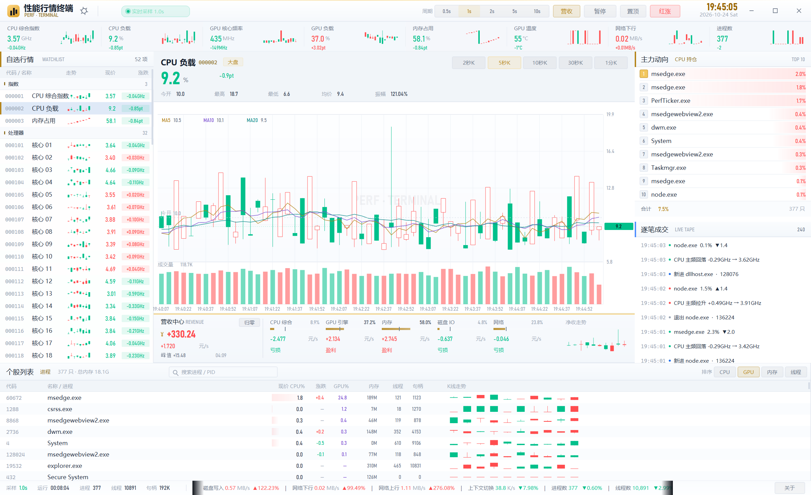

# 性能行情终端 · PerfTicker

> 把 Windows 任务管理器做成**炒股软件行情终端**：CPU / GPU 的频率、占用率、显存、温度、功耗……
> 每一项系统指标都是一只「个股」，实时 K 线、五档盘口、逐笔成交、自选行情一应俱全。
> 单文件 exe，双击即用，**无需安装 .NET 运行时**。
>
> 作者 **QiuSui** · 组织 **QiuSui_Studio** · 开源协议 **GPL-3.0**



---

## 一、这是什么

传统任务管理器是「列表」；PerfTicker 把同样的数据搬到**证券行情终端**的界面语言里：

| 证券概念 | 对应系统指标 |
| --- | --- |
| 指数条（上证/深证/创业板） | CPU 综合指数、CPU 负载、GPU 核心频率、GPU 负载、内存占用、GPU 温度、网络下行、进程数 |
| 自选股列表 | 52 项可监测指标（含 32 个逻辑核心逐个频率） |
| 个股代码 | `000001`、`600519`… 每个指标都有交易所风格的代码 |
| K 线 | 以采样点为 tick，按 2s / 5s / 10s / 30s / 1min 聚合成 OHLC K 线，含 MA5/10/20 与成交量 |
| 涨跌 / 涨跌幅 | 相对「今开」的变化；涨跌按各自单位显示（`+0.12GHz`、`-2.8pt`、`+0.4W`），品种头另附涨跌幅百分比 |
| 采样档位 | 0.5s / 1s / 2s / 5s / 10s；K 线周期会自动不低于采样间隔的 2 倍，避免出现「只有一条短线」的退化成 K 线 |
| 五档盘口 · 主力动向 | 当前指标维度下的 Top 10 进程，带热度条与名次徽标 |
| 逐笔成交 | 进程启停、主频跳变、温度/负载告警、活跃进程成交流水 |
| 沪深个股列表 | 全量进程表：PID / 名称 / CPU% / 涨跌 / GPU% / 内存 / 线程 / 句柄 / 迷你 K 线；支持搜索、置顶、右键全抛 |
| 跑马灯 | 全部指标的滚动快讯 |

**红涨绿跌** 遵循 A 股习惯，标题栏「红涨」按钮可一键切换为国际配色（绿涨红跌）。

---

## 二、界面结构

```
┌──────────────────────────────────────────────────────────────────────────┐
│ 品牌 · 实时采样状态 · 采样周期 · 暂停 · 置顶 · 配色 · 时钟 · 窗口按钮      │
├──────────────────────────────────────────────────────────────────────────┤
│ 指数条（8 格，含迷你 K 线）                                               │
├───────────────┬──────────────────────────────────┬───────────────────────┤
│ 自选行情       │ 品种头（现价/涨跌/今开/最高/最低）│ 主力动向（Top 10 进程）│
│ 按板块分组     │ K 线周期切换                     │ 热度条 + 名次徽标      │
│ 52 项          │ ─────────────────────────────    ├───────────────────────┤
│ 迷你 K 线      │ 主图：K 线 + MA + 成交量 + 十字  │ 逐笔成交（事件流水）   │
│ 现价 / 涨跌    │ 光标与 OHLC 浮窗                  │                       │
├───────────────┴──────────────────────────────────┴───────────────────────┤
│ 个股列表（进程表，可排序、滚动，每行一条迷你 K 线）                        │
├──────────────────────────────────────────────────────────────────────────┤
│ 采样/运行/进程/线程/句柄 + 跑马灯快讯 + 快捷键提示                         │
└──────────────────────────────────────────────────────────────────────────┘
```

---

## 三、设置 / 托盘 / 关于

- **左上角齿轮**（或标题栏）打开「设置」：`开机自启动`（写入 HKCU Run 项）、`底部滚动信息`开关、
  `界面主题`三档（深色 / 浅色 / 跟随系统，**默认浅色**），改动即时生效并自动保存。
- **关闭主窗口不会退出**：程序最小化到托盘，行情采样、经济结算继续在后台运行；
  鼠标悬停托盘图标立即显示 `CPU · GPU · 内存 · 营收`；右键菜单可 `打开主窗口` / `营收归零` / `退出`；双击图标恢复窗口。
- **右下角「关于」**：开发者 QiuSui、组织 QiuSui_Studio、GitHub / Bilibili 主页（可点击跳转）、开源协议 GPL-3.0。

## 四、交互

| 操作 | 说明 |
| --- | --- |
| 点击指数格 / 自选行 | 切换当前「品种」，主图、盘口、逐笔同步联动 |
| 点击 `2秒K`…`1分K` | 切换 K 线周期 |
| 鼠标悬停主图 | 十字光标 + OHLC / 涨跌 浮窗 |
| 点击「CPU / GPU / 内存 / 线程」 | 进程表排序（再次点击反向） |
| 进程搜索框（或 `Ctrl+F`） | 按进程名 / PID 过滤，`Esc` 清空 |
| 右键进程行 | 菜单：**全抛**（结束进程，二次确认） / **置顶到榜首** / 复制进程名 |
| 滚轮 | 自选列表 / 进程表平滑滚动（带缓动动画） |
| 滚轮 | 自选列表 / 进程表滚动 |
| 拖动标题栏 / 双击标题栏 | 移动窗口 / 最大化还原 |
| 拖动窗口边缘 | 无边框缩放 |

**快捷键**：`空格` 暂停/继续 · `1`-`5` K 线周期 · `E` 营收系统 · `Ctrl+F` 进程搜索 · `T` 窗口置顶 · `C` 红涨/绿涨 · `F5` 刷新 · `F11` 最大化 · `Esc` 还原/关闭菜单

**动效**：数值逐帧缓动（行情跳动感）、最新一根 K 线随采样生长、新 K 线滑入、坐标轴范围缓动、列表滚动缓动、涨跌闪色。动画只在有变化时触发，静止时几乎不占 CPU。

窗口位置、大小、采样周期、配色、选中品种、排序方式会自动记忆（`%LOCALAPPDATA%\PerfTicker\settings.json`）。

---

## 五、经济系统（算力经营）

标题栏「营收」开关（默认**关闭**，快捷键 `E`），开启后在图表下方划出**营收中心**专区：把每项占用率当成产能，
高负载持续越久赚得越多，空转则不断亏损。

| 经营单元 | 满载收益 | 盈亏平衡占用率 |
| --- | --- | --- |
| CPU 综合 | 22.0 元/s | 30% |
| GPU 引擎 | 30.0 元/s | 28% |
| 内存 | 12.0 元/s | 35% |
| 磁盘 IO | 7.2 元/s | 25% |
| 网络 | 7.2 元/s | 25% |

> 数值已按同一平衡等比放大 100 倍，手感与盈亏平衡点不变。
> 累计金额**固化在本地**（`settings.json` 的 `EcoTotal / EcoPeak / EcoSeconds`，每 15 秒与退出时落盘），
> 重启程序后继续累计；面板左上「归零」按钮或托盘菜单「营收归零」可清零。

结算规则（`Economy.NetOf`）：

```
净收益(元/s) = 满载收益 × (占用率/100)^1.7 − 空转成本
空转成本     = 满载收益 × (盈亏平衡点)^1.7
```

指数取 1.7 表示**边际递增**：占用率越高，单位负载带来的收益越多；低于平衡点则为负（空转成本）。
另外 GPU 温度 ≥72 / 78 / 84°C 时 CPU 与 GPU 收益分别打 95% / 88% / 78% 折（过热降效），
暂停（`空格`）时营收停止结算。

专区显示：累计营收（可为负）、每秒净收、峰值、本时段时长、五个部件的负载条（竖线为盈亏平衡点）与盈亏标签、
以及净收走势迷你 K 线。窄窗口下自动减少分项数量，宽窗口下显示全部五项 + 走势。

## 六、数据口径

| 指标 | 采集方式 | 口径 |
| --- | --- | --- |
| CPU 占用 | `NtQuerySystemInformation(SystemProcessorPerformanceInformation)` | 逐核心 busy/total，整机取平均 |
| CPU 频率 | PDH `\Processor Information(*)\% Processor Performance` × 标称频率；`CallNtPowerInformation` 兜底 | 与任务管理器「速度」一致 |
| 内存 | `GlobalMemoryStatusEx` | 物理内存占用率 / 已用 / 提交 |
| 进程 CPU / 内存 / 线程 / 句柄 | `NtQuerySystemInformation(SystemProcessInformation)` 单次快照 | CPU% 为整机占比（0–100） |
| GPU 频率 / 占用 / 显存 / 温度 / 功耗 / 风扇 | NVML（驱动自带 `nvml.dll`，运行时动态加载） | RTX / 专业卡 |
| GPU 引擎占用 / 逐进程 GPU | PDH `\GPU Engine(*)\Utilization Percentage` | 非 NVIDIA 或无 NVML 时的兜底 |
| 磁盘读写 / 网络上下行 | PDH 英文计数器（不受系统语言影响） | 字节/秒 |
| 成交量（K 线柱） | PDH `\System\Context Switches/sec` | 采样周期内累加 |
| 告警 | 温度 ≥82°C、GPU 负载 ≥92%、CPU ≥88%、内存 ≥90%、磁盘突发 ≥200MB/s | 逐笔成交中提示 |

> 所有采集均为**只读查询**，不修改系统任何状态；采样线程 `BelowNormal` 优先级，默认 1s 一次。

---

## 七、便携性

- 单文件、自包含（Self-contained + Single-file + 压缩），**目标机无需安装 .NET**。
- 体积约 **47 MB**，无需管理员权限，双击即运行。
- 首次启动约 2–3 秒（单文件解压原生库），之后为常规启动速度。
- 仅依赖 Windows 自带组件：`ntdll` / `pdh` / `powrprof` / `dwmapi`，NVIDIA 机器会自动使用驱动的 `nvml.dll`。

---

## 八、构建

需要 .NET 10 SDK（`dotnet --list-sdks` 应包含 10.x）：

```powershell
cd PerfTicker
dotnet publish -c Release -o ..\dist
# 产物：dist\PerfTicker.exe
```

关键工程设置（见 `PerfTicker.csproj`）：

```xml
<RuntimeIdentifier>win-x64</RuntimeIdentifier>
<SelfContained>true</SelfContained>
<PublishSingleFile>true</PublishSingleFile>
<IncludeNativeLibrariesForSelfExtract>true</IncludeNativeLibrariesForSelfExtract>
<EnableCompressionInSingleFile>true</EnableCompressionInSingleFile>
```

---

## 九、代码结构

```
PerfTicker/
├─ Program.cs          入口、单实例互斥、PerMonitorV2 DPI
├─ AppForm.cs          无边框窗口、命中测试、布局、定时器、数据落表、事件生成
├─ State.cs            全局状态（选中品种、周期、排序、逐笔、进程历史）
├─ Snapshot.cs         一次采样的不可变快照
├─ Probes.cs           PDH / CPU / GPU(NVML) / 进程 采集器 + 采样线程
├─ Native.cs           Win32 / NTDLL / POWRPROF / PDH 互操作声明
├─ Metrics.cs          指标目录（代码、单位、精度）与 tick / K 线聚合
├─ Theme.cs            深色证券终端视觉系统：配色、字体阶梯、圆角、迷你 K 线
├─ Panels.cs           标题栏 / 指数条 / 自选行情 / 品种头
├─ Panels2.cs          主力动向 / 逐笔成交 / 状态栏跑马灯
├─ ChartPanel.cs       主图：K 线 + MA + 成交量 + 十字光标
├─ ProcPanel.cs        个股列表（进程表）
├─ Settings.cs         设置持久化
├─ Economy.cs          经济系统账本（产能结算 / 过热降效）
├─ EconomyPanel.cs     营收中心专区
├─ AboutForm.cs        关于窗口（链接可点击跳转）
└─ Art.cs              运行时生成的应用图标
```

实现要点：全窗口 GDI+ 自绘（无原生控件），`TextRenderer` 走 GDI 保证中文小字清晰，
因此文字绘制使用 `Theme.TX/TY` 偏移补偿面板平移；重绘按面板裁剪，静态区域不重复绘制。

---

## 十、已知限制

- CPU 频率在**虚拟机 / 云主机**上可能被固化（该平台不提供动态频率计数器），会呈现平稳曲线；
  物理机上可见完整的升降频行情。
- 逐进程 GPU 占用依赖 PDH `GPU Engine` 计数器，部分驱动/精简系统可能无数据（显示 `—`）。
- 仅发布 `win-x64`。ARM64 需改用 `-r win-arm64` 重新发布。

---

## 十一、开源与致谢

| | |
| --- | --- |
| 开发者 | QiuSui |
| 组织 | QiuSui_Studio |
| GitHub | https://github.com/QiuSui1145/ |
| Bilibili | https://space.bilibili.com/1764510273 |
| 开源协议 | [GPL-3.0](LICENSE) |

本项目以 GNU General Public License v3.0 开源：可自由使用、修改、分发，衍生作品需同样以 GPL-3.0 开源并保留版权声明。