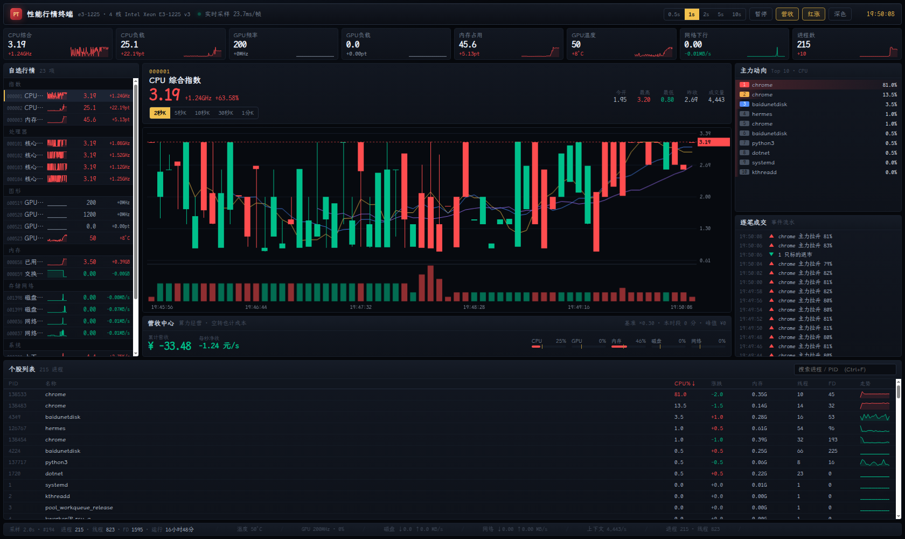

# PerfTicker · Linux Web 版

把 [PerfTicker](https://github.com/QiuSui1145/PerfTicker) 的**证券行情终端**搬到了 Linux + 浏览器：
无头服务器上跑一个采样服务，本机或局域网任何设备的浏览器打开就是全套行情界面。

> 原版是 Windows 专有的单文件 exe（WinForms + GDI+ 全自绘 + `ntdll`/`pdh`/`powrprof`/NVML），
> 在 Linux 上无法运行，Wine 也补不齐那些内核级计数器。所以这里**不改原版一行代码**，
> 另起一套 Linux 原生采集层 + Web 前端，界面语言、指标口径、K 线算法对齐原版。

## 界面



## 快速开始

```bash
cd linux
pip install -r requirements.txt

# 默认 0.0.0.0:8771，局域网可直接访问
python3 -m perfticker.server --host 0.0.0.0 --port 8771
```

浏览器打开 `http://<服务器IP>:8771` 即可。

只读采集，不需要 root（进程的 fd 计数对他人进程会返回 0，用 sudo 跑才完整）。

## 它显示什么

| 板块 | 内容 |
| --- | --- |
| 指数条 | CPU 综合指数、CPU 负载、GPU 频率、GPU 负载、内存占用、GPU 温度、网络下行、进程数 + 迷你走势 |
| 自选行情 | 23 项指标按板块分组，每项带迷你 K 线、现价、涨跌 |
| 品种头 | 选中指标的现价 / 涨跌 / 今开 / 最高 / 最低 / 成交量，2秒K～1分K 切换 |
| 主图 | OHLC 蜡烛（红涨绿跌实心）+ MA5/10/20 + 成交量 + 十字光标与 OHLC 浮窗 |
| 主力动向 | 当前维度 Top 10 进程，热度条 + 名次徽标 |
| 逐笔成交 | 进程上市/退市、CPU 高温、负载告警、磁盘网络放量等事件流水 |
| 个股列表 | 全量进程表：PID / 名称 / CPU% / 涨跌 / 内存 / 线程 / FD / 迷你走势，可排序、可搜索 |
| 营收中心 | 算力经营：把占用率当产能，空转计成本；过热降效 |

快捷键：`空格` 暂停 · `1`-`5` K 线周期 · `E` 营收 · `Ctrl+F` 进程搜索 · `C` 红涨/绿涨 · `Esc` 清空搜索

## 数据口径（Windows → Linux）

| 指标 | 原版（Windows） | 本版（Linux） |
| --- | --- | --- |
| CPU 占用 | `NtQuerySystemInformation` | `/proc/stat` 逐核 delta |
| CPU 频率 | PDH `% Processor Performance` × 标称频率 | `cpufreq/scaling_cur_freq` |
| 内存 | `GlobalMemoryStatusEx` | `/proc/meminfo`（`MemTotal - MemAvailable`） |
| 提交内存 | 提交大小（含页面文件） | Swap 使用量（语义最接近） |
| 磁盘吞吐 | PDH 物理磁盘计数器 | `/proc/diskstats`（只算物理盘，排除分区/loop/dm） |
| 网络吞吐 | PDH 网络计数器 | `/proc/net/dev`（排除 lo/veth/docker/br-） |
| 上下文切换 | PDH `Context Switches/sec` | `/proc/stat` 的 `ctxt` |
| 进程 CPU/内存/线程 | `NtQuerySystemInformation` | `/proc/<pid>/stat`、`/proc/<pid>/status` |
| 句柄数 | 内核句柄表 | 打开的文件描述符数（`/proc/<pid>/fd`） |
| GPU（NVIDIA） | NVML | `nvidia-smi` 查询（有卡自动用） |
| GPU（Intel 核显） | — | i915 的 `gt_cur_freq_mhz` + coretemp 温度；利用率用 `drm-engine` fdinfo 增量估算 |
| CPU 温度 | — | `coretemp` hwmon（Package + 逐核） |

K 线为前端按 2s/5s/10s/30s/1min 从 tick 聚合（等价于原版 `RebuildCandles`），
采样档位 0.5s～10s 可切，K 线周期自动不低于采样间隔的 2 倍。

## 目录

```
linux/
├── perfticker/
│   ├── collect.py     Linux 采集层（/proc、/sys、i915、nvidia-smi）
│   ├── metrics.py     指标目录 + tick 环形缓冲（对应 Metrics.cs / Catalog）
│   └── server.py      FastAPI + SSE 服务
├── static/
│   ├── index.html
│   ├── style.css      证券终端视觉（对应 Theme.cs）
│   └── app.js         K 线聚合、主图绘制、逐笔事件、营收系统
├── scripts/fetch_fonts.sh   可选：装霞鹜文楷 Web 字体
└── requirements.txt
```

## 字体

界面用**霞鹜文楷**（中文）/ **霞鹜文楷等宽**（数字）。没有字体文件时会回退到系统字体，不影响使用。
想还原截图效果，执行：

```bash
bash scripts/fetch_fonts.sh
```

## 已知差异

- Intel 核显没有原生 GPU 利用率计数器，用 `drm-engine` fdinfo 累计时间估算，无 GPU 客户端时显示 0。
- 核显与 CPU 同 die，无独立温度传感器时沿用 CPU 封装温度。
- 核显没有独立显存，不参与营收中心的 GPU 产能结算。
- 虚拟机/云主机上 CPU 频率常被固化，曲线会是一条直线（物理机才看得到升降频）。

## 许可

继承上游 [GPL-3.0](../LICENSE)。原版作者 QiuSui / QiuSui_Studio。
